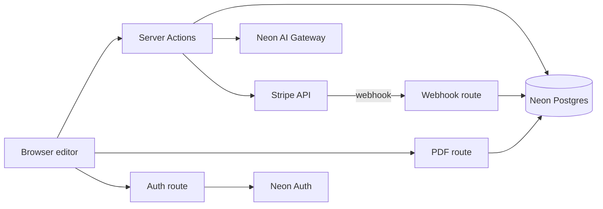

# AI Resume Builder — V1 Plan

**Contents:** Requirements · Technical Design · Assumptions & Open Risks · Testing · Delivery Steps

# Requirements

### Overview & Goals
Replace the Glimpse mockup in this Next.js 16.4.6 app with a simple, paid AI resume builder for general job seekers. Users build one ATS-friendly resume, improve it with AI, check it against a job description and download a text-based PDF. The brand is a placeholder in `lib/config.ts`.

This document is the single reference for V1 and can be revisited at any time.

### Decisions From the Interview
| Topic | Decision |
|---|---|
| Hosting | Cloudways Velocity (managed, always-on Node.js) |
| Database | Neon Postgres, AWS US East |
| Auth | Neon Auth (email/password + Google) |
| Storage | Neon Object Storage (unused in V1, reserved for resume import) |
| AI | Neon AI Gateway (OpenAI-compatible) |
| PDF | Server-side `@react-pdf/renderer` |
| Target users | General job seekers |
| Brand | Placeholder name in one constant |
| Resume storage | One JSONB document per resume |
| ORM | Drizzle ORM |
| First run | Empty dashboard with "Create resume" |
| Free limits | Lifetime totals (never reset) |
| Pro status | Stripe webhooks → `subscriptions` table |
| Pro billing | Monthly + annual |
| Server boundary | Server Actions (route handlers only for auth, webhook, PDF) |
| AI responses | Wait, then show full validated JSON |
| UI kit | Tailwind 4 + shadcn/ui |
| Environments | Local + production |
| Testing bar | Manual QA |
| Account deletion | Self-serve |

### Scope
**In scope:**
- Email and Google accounts
- Dashboard (list, create, delete resumes)
- Form editor with live preview and explicit Save
- One template
- Server-generated PDF
- AI bullet writer and improver
- AI summary
- Job match check
- Stripe Free and Pro plans (monthly and annual), with an upgrade dialog, Customer Portal and self-serve account deletion
- Landing, pricing, terms and privacy pages, with SEO

**Out of scope:** import/upload, multiple templates or styling, resume score, cover letters, autosave, drag-and-drop, dark mode, trials, lifetime plan, staging, automated tests, Sentry and analytics.

### Core User Flows
1. **Visitor:** lands on `/` (hero, how it works, features, pricing, FAQ), then signs up with email or Google.
2. **First login:** empty dashboard with a "Create resume" button.
3. **Editor (`/resumes/[id]`):** form on the left, live preview on the right (Edit/Preview tabs on mobile); explicit Save; unsaved-changes warning.
4. **AI actions:** write bullets, improve a bullet, generate a summary; spinner, then accept or discard.
5. **Job match:** paste a job description; see found vs. missing keywords.
6. **PDF download:** server-generated text PDF.
7. **Limit reached:** upgrade dialog → Stripe Checkout (monthly or annual).
8. **Settings:** Stripe Customer Portal (cancel, switch plan, invoices) and Delete account.

### Pages & Routes
- **Public, indexed:** `/`, `/pricing`, `/terms`, `/privacy`.
- **Auth pages:** `/auth/sign-in`, `/auth/sign-up`.
- **Protected, `noindex`:** `/dashboard`, `/resumes/[id]` (job match panel inside the editor), `/settings`.
- **Route handlers:** `/api/auth/[...path]` (Neon Auth), `/api/stripe/webhook`, `/api/resumes/[id]/pdf`.

### Pricing
| | Free | Pro |
|---|---|---|
| Price | $0 | $15/month or $120/year |
| Resumes | 1 at a time (deleting frees the slot) | Unlimited |
| PDF downloads | 1, lifetime | Unlimited |
| AI actions | 5, lifetime | Fair use: 300 per calendar month (UTC) |
| Job match | 1, lifetime | Unlimited (counts toward AI fair use) |

No trial. 30-day money-back guarantee handled by manual refunds in the Stripe dashboard.

### User Stories
- As a visitor, I want to understand the product and its pricing so I can decide to sign up.
- As a user, I want to fill in my resume and see a live preview so I know exactly what I'll download.
- As a user, I want AI to write and improve bullets and my summary so my resume reads professionally.
- As a user, I want to paste a job description and see which keywords I'm missing so I can tailor my resume.
- As a free user who has hit a limit, I want a clear upgrade path. As a Pro user, I want to manage or cancel my plan myself.
- As a user, I want to delete my account and all my data.

### Functional Requirements
- **Auth:**
  - Neon Auth, with email/password and Google sign-in.
  - Signed-out users are redirected away from `/dashboard`, `/resumes/*` and `/settings`.
  - New users land on an empty dashboard with a "Create resume" button.
- **Dashboard:** list resumes (title, last updated). Create resumes (Free: 1 at a time). Delete with confirmation.
- **Editor:**
  - Sections: Contact, Summary, Experience (with bullets), Education, Skills. Entries can be added, edited and deleted.
  - The preview updates from unsaved form state.
  - Save shows success or error.
  - Leaving with unsaved changes triggers a warning.
  - Desktop shows two columns; mobile switches between Edit and Preview tabs.
- **PDF:** text-based (selectable, ATS-readable) and laid out like the preview. Each download counts against limits.
- **AI:**
  - Bullets: job title, company and notes produce 3–5 bullets. Improve rewrites a single bullet. Summary is generated from the resume content.
  - Results appear after a spinner, and the user chooses to insert or discard.
  - Failed calls aren't charged.
- **Job match:** paste a job description of up to 10,000 characters. The app shows the extracted keywords marked found or missing, and the most recent result is saved for each resume.
- **Limits (lifetime for Free):**
  - Free: 1 resume, 1 PDF download, 5 AI actions, 1 job match.
  - Pro: unlimited, with a fair-use cap of 300 AI actions per calendar month (UTC), where job match checks count toward it.
  - When a limit is reached, an upgrade dialog opens.
- **Billing:**
  - Pro is $15/month or $120/year, bought through Stripe Checkout.
  - Pro status comes from webhooks and is stored in Postgres.
  - Settings opens the Stripe Customer Portal.
  - Pro means a subscription status of `active` or `past_due`.
- **Account deletion:** cancels the Stripe subscription, deletes the app data, then deletes the auth user.
- **Marketing:** landing page (hero, how it works, features, pricing, FAQ), `/pricing`, `/terms`, `/privacy`. These get metadata, OG tags, a sitemap and robots rules; app pages are `noindex`.

### Non-Functional Requirements
- Runs as an always-on Node.js app on Cloudways Velocity, with a Neon project in AWS US East (required for AI Gateway).
- Secrets are server-only, every query is scoped to the owner, and Stripe webhook signatures are verified.
- AI calls time out after 30 seconds and are throttled to about 10 per minute per user.
- Input caps: job description ≤ 10,000 characters, AI notes ≤ 1,000 characters.
- Responsive on desktop, tablet and mobile; light mode only; skeleton loading states, empty states and error toasts.

# Technical Design

### Current Implementation
- `app/page.tsx` and `app/globals.css` contain the static Glimpse social feed, and `app/layout.tsx` holds the Glimpse metadata. `public/images/*` holds the sample photos.
- `package.json` has `next` 16.4.6, `react` 19.3.0, and Tailwind 4.3.3 (installed but unused). There is no backend, database or tests.
- **Next.js 16 rule:** read `node_modules/next/dist/docs/` before coding. For example, `middleware` is now `proxy`, and the route handler and Server Action conventions should be checked there too.

### Key Decisions
- **Hosting:** Cloudways Velocity runs an always-on `next start`. No serverless constraints, so PDF rendering and AI calls run in-process.
- **Database:** Neon Postgres with Drizzle ORM and `drizzle-kit` migrations, run by hand before each deploy.
- **Resume storage:** one JSONB `content` document per resume, validated by a shared Zod schema. The editor, preview, PDF and AI all use the same shape.
- **Auth:** Neon Auth (Managed Better Auth) through its Next.js server SDK. The exact package name gets checked against the current docs.
- **Server boundary:**
  - Server Actions handle all app operations.
  - Route handlers are used only for auth (`/api/auth/[...path]`), the Stripe webhook and the PDF.
  - Every action follows `requireUser → ownership → assertLimit → work → recordUsage`.
- **AI:** the `openai` SDK pointed at the Neon AI Gateway (base URL and token from env, model from `AI_MODEL`, default `gpt-5-mini`). The app waits for the full JSON response and validates it with Zod.
- **Job match:** the AI extracts keywords, then code decides found or missing by searching the resume text. This gives reproducible results.
- **PDF:** `@react-pdf/renderer` with the built-in Helvetica font, so the PDF contains real text.
- **Billing:** Stripe Checkout and Customer Portal. Webhooks write to `subscriptions`, each event is processed once (via `stripe_events`), and the subscription is re-fetched from Stripe on each event.
- **UI:** Tailwind 4 with shadcn/ui and toasts. Light mode only.
- **Limits:** counted from `usage_events`, with all numbers in one `lib/plans.ts` config.

### Data Models / Contracts
```ts
// db/schema.ts (Drizzle)
resumes      { id uuid pk, userId text, title text, content jsonb, template text default 'classic', createdAt, updatedAt }
jobMatches   { id uuid pk, resumeId uuid fk→resumes cascade, userId text, jobDescription text, keywords jsonb, createdAt }
usageEvents  { id uuid pk, userId text, kind 'ai_action'|'pdf_download'|'job_match', createdAt }  // index (userId, kind, createdAt)
subscriptions{ userId text pk, stripeCustomerId text unique, stripeSubscriptionId text, priceId text, interval text, status text, currentPeriodEnd timestamptz, cancelAtPeriodEnd bool, updatedAt }
stripeEvents { eventId text pk, createdAt }

// lib/resume/schema.ts (Zod)
ResumeContent = { contact:{fullName,email,phone,location,linkedin,website}, summary:string,
  experience:{id,jobTitle,company,location,startDate,endDate,current,bullets:string[]}[],
  education:{id,school,degree,field,startDate,endDate}[], skills:string[] }

// Server Action result
type ActionResult<T> = { ok: true; data: T } | { ok: false; code: 'UNAUTHORIZED'|'NOT_FOUND'|'LIMIT_REACHED'|'INVALID'|'AI_FAILED'; feature?: Feature; message?: string }

// lib/plans.ts
PLANS = { free: { resumes: 1, pdf: 1, ai: 5, jobMatch: 1 /* lifetime */ }, pro: { aiPerMonth: 300 } }
assertLimit(userId, feature): Promise<void /* throws LimitError */>

// lib/ai/*.ts
generateBullets({jobTitle, company, notes}): Promise<string[]>   // 3–5
improveBullet({bullet, jobTitle}): Promise<string>
generateSummary(content: ResumeContent): Promise<string>
extractKeywords(jobDescription): Promise<{keyword, importance}[]> // then matchKeywords(content, keywords)
```

### File Structure
```
plan.md                       # this document (full V1 plan reference)
lib/config.ts                 # placeholder brand name, app URL
lib/plans.ts                  # limits, prices, isPro()
lib/db/index.ts, db/schema.ts # Drizzle + Neon client; drizzle.config.ts, drizzle/ migrations
lib/auth/server.ts, lib/auth/client.ts, lib/auth/require-user.ts
lib/resume/schema.ts          # Zod ResumeContent + empty template
lib/usage.ts                  # recordUsage, counts, assertLimit
lib/ai/client.ts, bullets.ts, summary.ts, job-match.ts
lib/stripe.ts                 # client, checkout/portal helpers, syncSubscription
lib/pdf/ResumeDocument.tsx    # React-PDF template
proxy.ts                      # Next 16 route protection
app/layout.tsx, app/globals.css            # modified: Tailwind + shadcn base
app/(marketing)/page.tsx, pricing/, terms/, privacy/   # replaces old app/page.tsx
app/(auth)/auth/[path]/page.tsx
app/(app)/layout.tsx, dashboard/, resumes/[id]/, settings/
app/(app)/**/actions.ts       # resume, ai, job-match, billing, account actions
app/api/auth/[...path]/route.ts, app/api/stripe/webhook/route.ts, app/api/resumes/[id]/pdf/route.ts
app/sitemap.ts, app/robots.ts
components/ui/* (shadcn), components/editor/*, components/resume/ResumePreview.tsx, components/upgrade-dialog.tsx
.env.example
public/images/* (Glimpse photos) — removed
```

### Architecture Diagram

The browser calls Server Actions for data, AI and billing, and calls route handlers for the PDF and auth. Stripe pushes subscription changes to the webhook route. Every limit check reads Postgres only.

### Environments & Configuration
- **Local:** Neon dev branch, Stripe test mode, Stripe CLI forwarding webhooks to `/api/stripe/webhook`.
- **Production:** Neon main branch, live Stripe keys, Cloudways Velocity deploying from GitHub `main`.
- **Migrations:** `drizzle-kit migrate` run by hand before each deploy.
- **Env vars (`.env.example`):**
  - Neon: `DATABASE_URL`, `NEON_AUTH_BASE_URL`, `NEON_AUTH_COOKIE_SECRET`, `NEON_AI_GATEWAY_BASE_URL`, `NEON_AI_GATEWAY_TOKEN`
  - AI: `AI_MODEL` (default `gpt-5-mini`)
  - Stripe: `STRIPE_SECRET_KEY`, `STRIPE_WEBHOOK_SECRET`, `STRIPE_PRICE_MONTHLY`, `STRIPE_PRICE_ANNUAL`
  - App: `NEXT_PUBLIC_APP_URL` (the only public variable)
- **Observability:** structured server logs in Velocity; `usage_events` provides core business metrics. No Sentry or analytics in V1.
- **Stripe webhooks handled:** `checkout.session.completed`, `customer.subscription.created`, `customer.subscription.updated`, `customer.subscription.deleted`.

### Future-Proofing (supported, not built)
- JSONB `content` and the `template` column allow new sections, templates and a resume score later.
- `usage_events.kind` can track new features such as cover letters.
- Neon Object Storage is ready for resume import.
- The `saveResume` action can be reused for autosave.

### Risks
- **Neon AI Gateway is in beta:** everything goes through `lib/ai/client.ts`, so moving to OpenAI directly is only an env change.
- **Neon Auth SDK naming and Next 16 `proxy` support:** check against the current docs at implementation time. Every action also checks the session itself.
- **Preview vs PDF drift:** both renderers follow the same section order, spacing and typography. `@react-pdf/renderer` must also be checked against React 19.3 (add it to `serverExternalPackages` if needed).
- **Webhook events out of order:** always re-fetch the subscription from Stripe on each event, and process each event once.
- **Free tier abuse through extra accounts:** accepted for V1. Email verification reduces it if Neon Auth supports it.

# Assumptions & Open Risks

### Assumptions
- Annual Pro price is $120/year; Customer Portal handles plan switches and cancellation; no trial.
- Pro counts as `status ∈ {active, past_due}`.
- Free resume limit is "1 at a time" — deleting frees the slot.
- Pro AI fair use is 300 actions per calendar month (UTC); job match checks count toward it.
- AI model defaults to `gpt-5-mini` via `AI_MODEL`.
- Job match: AI extracts 10–20 keywords; code checks presence in the resume text (normalized, case-insensitive).
- AI throttle ≈ 10 requests/minute per user; input caps 10,000 chars (job description) and 1,000 chars (notes).
- Terms and Privacy use template text until real legal copy exists.
- No dark mode, Sentry or analytics in V1.
- Migrations are run manually before each deploy.
- 30-day money-back guarantee is handled with manual Stripe refunds.

### Open Risks / Unknowns
1. **Neon AI Gateway beta:** requires ≥ $5 prepaid credit; availability or pricing may change. Mitigation: all AI code in `lib/ai/` behind an OpenAI-compatible client, so switching providers is an env change.
2. **Neon Auth maturity:** package naming (`@neon/auth` vs `@neondatabase/auth`), Next.js 16 `proxy` support, email verification and password reset must be confirmed against current docs.
3. **Preview vs PDF drift:** two renderers; both follow one layout spec. `@react-pdf/renderer` compatibility with React 19.3 / Next 16 must be checked.
4. **Free-tier abuse via extra accounts:** accepted for V1; email verification reduces it.
5. **Manual QA only:** billing and limit bugs are most likely to slip through; test webhooks with the Stripe CLI before launch.
6. **Webhooks and auth on Cloudways:** Stripe must reach the domain over HTTPS, and `X-Forwarded-Proto` / `Host` headers must be correct for auth callbacks.
7. **Not yet decided:** deadline, monthly budget, final product name, real legal text.

# Testing

### Validation Approach
You chose manual QA as the bar for V1, so there are no automated test suites. After each stage, I'll run `npm run lint` and `npm run build` and smoke-test the dev server with a Neon dev branch and Stripe test mode (webhooks forwarded with the Stripe CLI).

### Key Scenarios
- Sign up with email or Google, then see the empty dashboard. Signed-out visits to `/dashboard` redirect to sign-in.
- Create a resume, edit every section, see the live preview update, then Save and reload to confirm the content persisted.
- Download the PDF and confirm its text is selectable or extractable.
- Generate bullets, improve a bullet, generate a summary, and insert the results.
- Run a job match and confirm the found and missing keywords are correct.
- As a Free user, exceed each limit and confirm the upgrade dialog. Complete Checkout with a test card, confirm Pro limits apply, then open the Portal and cancel to return to Free.
- Delete the account and confirm the data, the subscription and the auth user are all gone.

### Edge Cases
- An AI timeout or invalid JSON shows an error toast and records no usage.
- An oversized job description or invalid form input is rejected.
- Accessing another user's resume ID returns not found.
- A duplicate webhook event is ignored. A webhook with a bad signature gets a 400.
- On mobile, the editor and preview tabs work without horizontal overflow.

# Delivery Steps

###   Step 1: Set up foundation: Tailwind/shadcn, Drizzle schema, config
The app compiles on a clean Tailwind and shadcn base, with the Neon database schema migrated and the Glimpse mockup removed.
- Read the relevant Next.js 16 docs in `node_modules/next/dist/docs/` before writing code (proxy, route handlers, Server Actions).
- Install `drizzle-orm`, `drizzle-kit`, the Neon driver, `zod`, the `openai` SDK, `stripe`, `@react-pdf/renderer` and `sonner`. Initialize shadcn/ui on Tailwind 4.
- Remove the Glimpse `app/page.tsx` content, its CSS and `public/images/*`. Reset `app/layout.tsx` and `app/globals.css`.
- Add `lib/config.ts` (placeholder brand), `lib/plans.ts` (limits and prices), `lib/resume/schema.ts` (Zod `ResumeContent` plus an empty resume), and `db/schema.ts` with all five tables.
- Add `lib/db`, `drizzle.config.ts`, the first migration and `.env.example`.
- Verify with lint, build and the migration applied to a Neon dev branch.

###   Step 2: Add Neon Auth, route protection and resume dashboard
Users can sign up or sign in with email or Google and manage their resumes on a protected dashboard.
- `lib/auth/server.ts` and `lib/auth/client.ts`, the `app/api/auth/[...path]/route.ts` handler, and sign-in and sign-up pages.
- `proxy.ts` protects `/dashboard`, `/resumes/*` and `/settings`. A `requireUser()` helper is used in every action.
- An `(app)` layout with a header and user menu.
- `/dashboard`: list resumes, an empty state, and create and delete actions with confirmation.
- `lib/usage.ts` with `assertLimit` and `recordUsage`. The Free 1-resume limit returns `LIMIT_REACHED`.
- Check sign-up, redirects and create/delete by hand.

###   Step 3: Build resume form editor with live preview and Save
Users can edit every resume section and see a live preview that persists on Save.
- `/resumes/[id]` loads the resume, checking ownership, and passes it to a client editor.
- Section forms for Contact, Summary, Experience (with bullets), Education and Skills, with add, edit and delete.
- `components/resume/ResumePreview.tsx` renders the single ATS template from form state.
- A `saveResume` Server Action validates with Zod, updates `content`, `title` and `updatedAt`, and shows a toast.
- An unsaved-changes warning, a two-column desktop layout, and Edit/Preview tabs on mobile.

###   Step 4: Implement text-based PDF download
Users can download an ATS-readable PDF that matches the preview, counted against plan limits.
- `lib/pdf/ResumeDocument.tsx` reproduces the preview layout using the React-PDF built-in fonts.
- `app/api/resumes/[id]/pdf/route.ts` checks auth, ownership and `assertLimit('pdf')`, renders the PDF, records usage, and returns it as an attachment.
- A Download button in the editor that saves first if there are unsaved changes, and opens the upgrade dialog when the limit is hit.
- Check that the PDF text is selectable and that the Free limit of 1 download is enforced.

###   Step 5: Add AI writer, summary and job match via Neon AI Gateway
Users can generate and improve bullets, generate a summary, and run a job match check, all within plan limits.
- `lib/ai/client.ts`: OpenAI SDK pointed at the Neon AI Gateway base URL and token, with `AI_MODEL`, a 30-second timeout and Zod-validated JSON.
- `generateBullets`, `improveBullet`, `generateSummary` and `extractKeywords`, plus a code-side `matchKeywords` that checks the resume content.
- Server Actions apply auth, ownership, `assertLimit`, a throttle of about 10 per minute, and record usage only on success.
- Editor UI: a bullet-writer dialog, an Improve button on each bullet, a Generate summary button, and a job match panel that saves to `job_matches`.
- `components/upgrade-dialog.tsx` opens on `LIMIT_REACHED`, and errors show as toasts.

###   Step 6: Integrate Stripe billing, settings and account deletion
Users can upgrade to Pro (monthly or annual), manage their billing, and delete their account.
- `lib/stripe.ts`: create or reuse the customer, plus Checkout (monthly and annual prices) and Portal session helpers.
- `app/api/stripe/webhook/route.ts`: verify the signature, process each event once via `stripe_events`, and sync `subscriptions` on the checkout and subscription events.
- `isPro()` in `lib/plans.ts` drives `assertLimit`: unlimited use with 300 AI actions a month for Pro, lifetime limits for Free.
- The upgrade dialog and pricing buttons start Checkout.
- `/settings` shows the plan and opens the Portal.
- `deleteAccount` cancels the subscription, deletes app rows, then deletes the Neon Auth user.
- Test the full upgrade and cancel cycle with Stripe test mode and the CLI.

###   Step 7: Build landing, pricing, legal pages and SEO
Public marketing pages explain the product and sell Pro, with proper SEO.
- An `(marketing)` route group: landing page (hero, how it works, features, pricing, FAQ, CTA), `/pricing` with a monthly/annual toggle, and `/terms` and `/privacy` with template text.
- Metadata and Open Graph for public pages; `noindex` on app routes; `app/sitemap.ts` and `app/robots.ts`.
- Responsive layout using the placeholder brand from `lib/config.ts`.
- Final lint and build, plus a full manual QA pass from signup to account deletion.